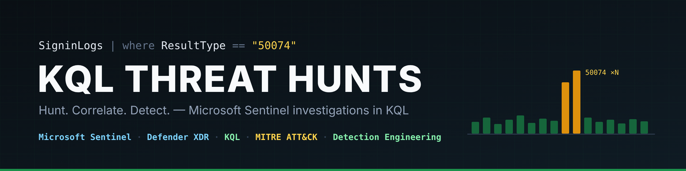

# KQL Threat Hunts

Hands-on threat hunting in **Microsoft Sentinel** and **Defender XDR** using **KQL (Kusto Query Language)**.
Each hunt is a scenario-based investigation: scope the incident, pivot through cloud telemetry, separate attacker activity from the victim's, and turn findings into detections.

**Author:** James Wood · [LinkedIn](https://www.linkedin.com/in/jamesmwood22/)

---

## Hunts

| # | Hunt | Scenario | Key techniques | Write-up |
|---|---|---|---|---|
| 02 | Scattered Invoice | Business email compromise of a finance user | MFA fatigue, inbox-rule persistence, thread-hijack BEC | [Report](hunt-02-scattered-invoice/README.md) · [PDF](hunt-02-scattered-invoice/report.pdf) |

## Detections

Rules built from hunt findings, aimed at attacker **behaviour** (TTPs) rather than IOCs that change between campaigns.

| Detection | Targets | MITRE ATT&CK |
|---|---|---|
| [MFA fatigue](detections/mfa-fatigue.kql) | Repeated MFA prompts followed by a success | T1621 |
| [Suspicious inbox rule](detections/suspicious-inbox-rule.kql) | New rules that forward or delete mail and stop processing | T1564.008, T1114.003 |

## Skills demonstrated

- KQL: filtering, `summarize`, `mv-expand`, `parse_json`, `serialize` + `prev()`, `let` / `toscalar`, `union`
- Microsoft Entra ID sign-in analysis (result codes, Conditional Access, session IDs)
- Exchange Online / M365 audit analysis (`CloudAppEvents` RawEventData)
- Evidence handling: stating what each data source proves and does not prove
- Pyramid of Pain and MITRE ATT&CK mapping
- Incident containment and hardening recommendations

## Tools

Microsoft Sentinel · Microsoft Defender XDR (Advanced Hunting) · VS Code · Git / GitHub

> All data comes from a simulated training range. Accounts, IPs and domains are fictitious lab infrastructure.
